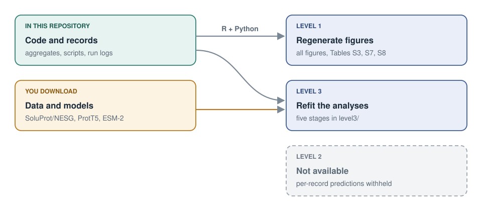
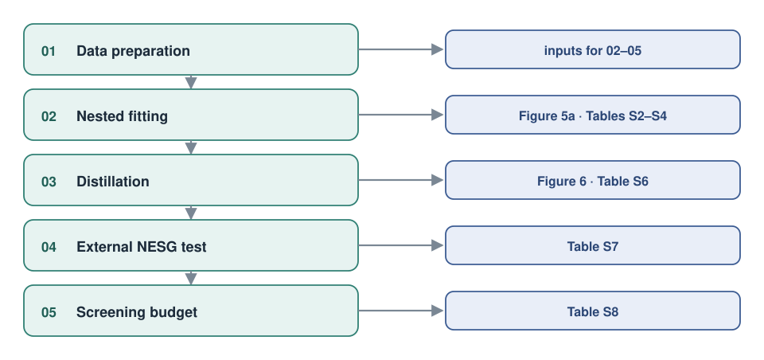

# Protein language models for solubility-related prediction: a practical workflow

Code, aggregate records and run records for the article

> Okada H, Ishikawa S, Miyamoto T, Kosuge H, Masuda T, Mori M, Nakakido M, Matsunaga R, Tsuchiya K,
> Chung U, Numata K, Sakai T, Hojo H. Protein language models for solubility-related prediction:
> a practical workflow. *Science and Technology of Advanced Materials: Methods* (2026).
> doi: [10.1080/27660400.2026.2767647](https://doi.org/10.1080/27660400.2026.2767647)

The article is the reference for every claim. This repository lets you regenerate its figures and
supplementary tables and inspect or rerun the analyses behind them.

<p align="center"></p>

## Repository layout

| Folder | What it holds |
|---|---|
| [`level1/`](level1/) | Figure and table code, the aggregate records it reads, and the literature and data audit |
| [`level3/`](level3/) | The analyses as they were run, in five stages, with their run records |
| [`docs/`](docs/) | [Stage-by-stage execution record](docs/STAGE_RECORD.md), [environment and seeds](docs/ENVIRONMENT.md), [third-party sources](docs/THIRD_PARTY.md), [data licence](docs/LICENSE-CC-BY-4.0.md) |
| [`env/`](env/) | Python requirements and the R package list |
| [`educational_cli/`](educational_cli/) | A bring-your-own-data teaching tool and a synthetic demo input; not a result of the article |
| [`tools/`](tools/) | `MANIFEST_SHA256.tsv` for every file, and `verify_manifest.py` |

## Level 1: regenerate the figures and tables

Needs R (packages in [`env/R_DEPENDENCIES.md`](env/R_DEPENDENCIES.md)) and Python ≥ 3.10; nothing to download.

```bash
cd level1
mkdir -p figures tables
Rscript scripts/make_method_flow_s18.R        # Figure 1
Rscript scripts/make_task_workflows.R         # Figure 2
Rscript scripts/make_interface_figures_s2.R   # Figure 3
Rscript scripts/make_figures.R                # Figure 4
Rscript scripts/make_figure_auc_s6.R          # Figure 5
Rscript scripts/make_figure_distillation.R    # Figure 6
Rscript scripts/make_graphical_abstract.R     # graphical abstract
python scripts/build_released_aggregate_diagnostics_s6.py   # Table S3
python scripts/make_supp_table_s7_external.py               # Table S7
python scripts/make_supp_table_s8_screening_budget.py       # Table S8
```

Before release, every output was regenerated from this repository and compared with the published
artwork and tables: the figures and the graphical abstract were pixel-identical, and Tables S3, S7
and S8 byte-identical. The scripts keep the file names of the accepted manuscript, whose figure order
differs from the published one:

| Published | Content | Output file |
|---|---|---|
| Figure 1 | Overview of the review and workflow | `figures/Okada_Fig1.*` |
| Figure 2 | Prediction and distillation procedures | `figures/Okada_Fig2.*` |
| Figure 3 | PepSol Explorer static synthetic record | `figures/Okada_Fig6.*` |
| Figure 4 | Dataset scale by endpoint family | `figures/Okada_Fig3.*` |
| Figure 5 | Within-development grouped ROC-AUC | `figures/Okada_Fig4.*` |
| Figure 6 | Distillation | `figures/Okada_Fig5.*` |

Tables S1, S2, S4, S5 and S6 are typeset text; the values in S2, S4 and S6 are in
`level1/analysis_addon/results/`. Re-deriving the audit counts behind Figure 4 needs the third-party
source files (`level1/scripts/reproduce_audits.sh`), which are not redistributed; their checksums
are in [`docs/THIRD_PARTY.md`](docs/THIRD_PARTY.md).

## Level 3: refit the analyses

<p align="center"></p>

Each stage folder holds the code, configuration, frozen protocol and aggregate run records; see
[`level3/README.md`](level3/README.md) for where each item of the article's Code availability
statement is and in which order to run the stages. [`docs/STAGE_RECORD.md`](docs/STAGE_RECORD.md)
states what was executed end to end on the full data, what only on reduced or synthetic inputs, and
where a record is missing. Refitting reproduces the analysis, not bitwise-identical values across
hardware and library builds.

The code is published as run and refers to no folder on the authors' computer. Local paths are
written as `${WORKSPACE}` (a folder of your choice) or `${HOME}`, and the few lines that had hard-coded
a local path now resolve it portably. Before running a stage, set the `paths:` block of its
configuration to your own folders. Some stage scripts still locate sibling stages and their run
outputs by the folder names used during the analysis; [`level3/README.md`](level3/README.md) explains
what to adapt. `python tools/verify_manifest.py` checks every file against the manifest, which also
records the as-run SHA-256 of each published file that differs from the file as run.

### Data and models you obtain yourself

- **SoluProt training set and NESG test set** — from the distribution accompanying Hon et al.,
  *Bioinformatics* 37(1):23–28 (2021), doi:[10.1093/bioinformatics/btaa1102](https://doi.org/10.1093/bioinformatics/btaa1102).
  Match the files to the SHA-256 values in
  [`level3/01_data_preparation/records/soluprot_provenance_audit.json`](level3/01_data_preparation/records/soluprot_provenance_audit.json).
- **Protein language models** — from the Hugging Face Hub at the pinned revisions, under each
  model's licence:

  | Model | Hub identifier | Revision | Used for |
  |---|---|---|---|
  | ProtT5-XL (encoder, half precision) | `Rostlab/prot_t5_xl_half_uniref50-enc` | `94a6abc029ae13029317b140b7424e012bf8dfbf` | Teacher (B1+ProtT5) |
  | ESM-2 650M | `facebook/esm2_t33_650M_UR50D` | `08e4846e537177426273712802403f7ba8261b6c` | Fixed-audit hybrid arm |
  | ESM-2 35M | `facebook/esm2_t12_35M_UR50D` | `6fbf070e65b0b7291e7bbcd451118c216cff79d8` | Small-pLM student (Figure 6) |

  For example: `huggingface-cli download Rostlab/prot_t5_xl_half_uniref50-enc --revision 94a6abc029ae13029317b140b7424e012bf8dfbf`.

## Not included

Sequences from the analysed datasets (the only sequences here are synthetic demo inputs), other
row-level data, per-record predictions, embeddings, teacher-target caches, fitted model weights, pLM
checkpoints, third-party source files, and PepSol Explorer, a private collaborator-evaluation
application that is not cleared for public distribution. The article itself is available at the DOI
above.

## Licence and citation

Code: MIT ([`LICENSE`](LICENSE)). Aggregate records, documentation, diagrams and generated figures:
CC BY 4.0 ([`docs/LICENSE-CC-BY-4.0.md`](docs/LICENSE-CC-BY-4.0.md)), with the exceptions listed
there. Third-party data and models keep their own terms. Please cite the article
([`CITATION.cff`](CITATION.cff)).
